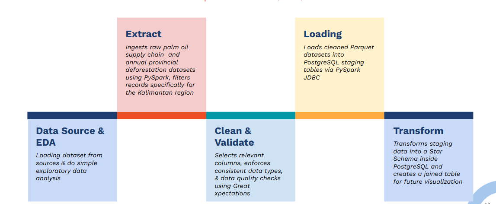
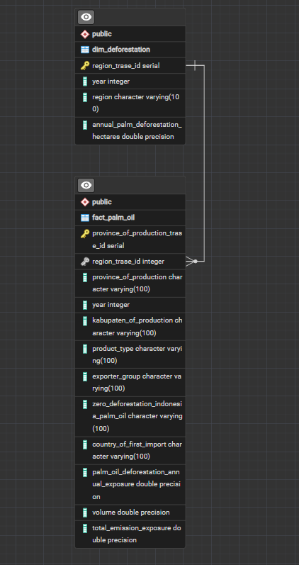

# **Tracing the Footprint: Identifying High-Risk Sourcing & Safer Suppliers in Kalimantan (2018–2024)**

### **Main Dataset Resource**:
https://trase.earth/open-data/datasets/supply-chains-indonesia-palm-oil
### **Supporting Dataset Resource**:
https://trase.earth/open-data/datasets/spatial-metrics-indonesia-palm-oil-palm-oil-deforestation-annual
### Team :
**Data Engineer & Airflow Pipeline**: Ryan Farid Pratama <br>
**Database & Data Modeling**: Muhammad Hanif Al Abid <br>
**Data Analyst**: Narda Parama Agung Noviantoro

## **Background**
Oil palm expansion has been an important driver of deforestation in Indonesia for the past 20 years, accounting for one third (3 million hectares) of Indonesia's loss of old-growth forest (Trase, 2024).
In recent years, deforestation for industrial palm oil has been concentrated in the forest-rich provinces of Kalimantan. Four Kalimantan provinces accounted for 72% of all palm oil deforestation in Indonesia in 2018 to 2022 (Trase / SEI).
Many exporters have zero-deforestation commitments, but the results are mixed: in 2021 to 2022, exporters with and without commitments sourced palm oil from areas with statistically similar deforestation rates (Trase / SEI).

## Stakeholder
The stakeholder in this case are the sustainability/procurement team of a companny planning to buy palm oil from Kalimantan.

## **SDG**
| SDG | Focus | Connection with Indonesian Palm oil |
|---|---|---|
| **SDG 15** | Life on Land | Deforestation and Habitat Loss, Land Degradation and Peatlands, and Sustainable Solution |

## **Data Engineering (Pipeline & Infrastructure)**
The Data Engineering workflow is built to process raw Kalimantan palm oil supply chain and annual deforestation datasets into an analytics-ready state through the following stages:

### A. Pipeline Workflow (ELTL & Validation)

The pipeline follows an **ELTL (Extract → Clean & Validate → Load → Transform in Warehouse)** architecture:
- **Extraction (`extract.py`)**: Ingests raw palm oil supply chain (`palm_oil_data_raw.csv`) and annual provincial deforestation (`palm_oil_deforestation_annual_province_raw.csv`) datasets using **PySpark**, filters records specifically for the **Kalimantan** region, standardizes column names to `snake_case`, and writes intermediate **Parquet** files to `temp_data/raw/`.
- **Cleaning & Data Validation (`clean_validate.py`)**:
  - **Data Cleaning**: Selects relevant columns, enforces consistent data types, handles `NULL` values, and removes duplicate records—resulting in **588,476** palm oil rows and **125** deforestation rows.
  - **Data Validation**: Executes automated data quality checks using **Great Expectations** before writing validated outputs to `temp_data/clean/`.
- **Loading (`load.py`)**: Loads cleaned Parquet datasets into **PostgreSQL** staging tables (`stg_palm_oil` and `stg_palm_deforestation`) via **PySpark JDBC** using `overwrite` mode for idempotency, followed by an automated row-count verification check using `psycopg2`.
- **Transformation (`Schema.sql` & `join_query.sql`)**: Transforms staging data into a **Star Schema** inside PostgreSQL and creates a unified analytical view (`palm_oil`) for downstream exploration and visualization.

### B. Airflow Orchestration
- **DAG Structure**: Uses a single DAG (`elt_DAG.py`, DAG ID: `palm_oil_deforestation_etl`) consisting of **3 sequential tasks**: `extract` → `clean_validate` → `load`.
- **Execution**: Orchestrated via `BashOperator`, running each stage as an independent Python subprocess inside `/workspace/dags/`. Configured with `max_active_runs=1` to prevent concurrent Spark sessions from exceeding container memory limits.
- **Schedule**: Scheduled to run automatically every day (`@daily` / `0 0 * * *` UTC, or **07:00 WIB**) with `catchup=False`.
- **Retry Policy**: Configured with **1 automatic retry** and a **1-minute retry delay** upon task failure.

### C. Environment & Infrastructure
- **Docker Setup**: Built with **Docker Compose** (`docker-compose.yml` & `Dockerfile`) to run Apache Airflow, Apache Spark (**PySpark**), and **PostgreSQL** in an integrated containerized environment, pre-installed with `pyspark`, `great_expectations`, `pandas`, `psycopg2`, and the PostgreSQL JDBC Driver.
- **Storage Volume & Repository Management**: The `workspace/` directory (containing `dags/`, `gx/`, `notebooks/`, and `Schema/`) is mounted as a local volume so intermediate Parquet files (`temp_data/`) persist across container restarts, while large raw CSV files and `.env` credentials are excluded via `.gitignore`.

### Database & Data Modeling 
Transforming palm oil and deforestation data into an organized relational database structure, by separating deforestation information by province, product and supporting factors into fact and dimension tables to facilitate analysis.

#### Database Architecture 

The database architecture is designed using *Star Schema*, which consists of:
* **Fact Table (`fact_palm_oil`)**: Stores key case metrics and relationship keys (*Foreign Keys*).
* **Dimension Tables**: Separating detail attributes to avoid data redundancy, which includes:
  * `dim_deforestation`: year, region, annual_palm_deforestation_hectares, 
  * `dim_province`: province_of_production_trase_id, province_of_production, kabupaten_of_production
  * `dim_product`: product_type, exporter_group, zero_deforestation_indonesia_palm_oil, country_of_first_import
### Data Preparation
#### Data Type Formatting & Integrity
Implement strict Primary Keys and Foreign Keys between tables to prevent data inconsistencies during the merge process.

### SQL & Analytics
To support analysis and answer various research questions (*Key Questions*) without having to repeatedly compose complicated `JOIN` syntax, centralized *SQL Views* were designed that connect *fact tables* with various dimension tables such as demographics, exploits, and recruiters..

the example of *SQL View* for analisys demography:

```sql
create view palm_oil AS
SELECT f.*, p.province_of_production, p.kabupaten_of_production,
       pr.product_type, pr.exporter_group,
       pr.zero_deforestation_indonesia_palm_oil, pr.country_of_first_import,
       d.annual_palm_deforestation_hectares
FROM fact_palm_oil f
JOIN dim_province p ON f.province_key = p.province_key
JOIN dim_product pr ON f.product_key = pr.product_key
LEFT JOIN dim_deforestation d
    ON f.region_trase_id = d.region_trase_id AND f.year = d.year;
```
## **Data Dictionary** 

#### A. Deforestation (dim_deforestation)
| Column | Data Type | Definisi |
|---|---|---|
| `region_trase_id` | varchar | Primary key yang menjadi identitas unik setiap data region |
| `year` | integer | year |
| `region` | varchar(100)  | region name |
| `annual_palm_deforestation_hectares` | float | big deforestation happen |

---

#### B. Province (dim_province)
| Column | Data Type | Definisi |
|---|---|---|
| `province_key` | serial | Primary key yang menjadi identitas unik setiap data province |
| `province_of_production_trase_id` | varchar(100) | penomoran id |
| `province_of_production` | varchar(100) | name of province production |
| `kabupaten_of_production` | varchar(100) | name of kabupaten production |

---

#### C. Product (dim_product)
| Column | Data Type | Definisi |
|---|---|---|
| `product_key` | serial | Primary key yang menjadi identitas unik setiap data product |
| `product_type` | varchar(100) | name of the product type |
| `exporter_group` | varchar(100) | name of the exporter_group |
| `zero_deforestation_indonesia_palm_oil` | varchar(100) | show zero |
| `country_of_first_import` | varchar(100) | name of the first import country |

---

#### D. Palm Oil (fact_palm_oil)
| Column | Data Type | Definisi |
|---|---|---|
| `fact_id` | serial | Primary key yang menjadi identitas unik setiap data hubungan recruiter |
| `province_key` | integer | foreign key that connect fact_palm with dim_province |
| `product_key` | integer | Mforeign key that connect fact_palm with dim_product |
| `region_trase_id` | varchar(100) | id regin trase |
| `year` | integer | year |
| `palm_oil_deforestation_annual_exposure` | float |  |
| `volume` | float |  |
| `total_emission_exposure` | float |  |

## **Problem Statement**
We help the sustainability/procurement team of a palm oil buying company avoid sourcing from high deforestation risk areas, by analysing Trase palm oil supply chain data from 2018 to 2024 joined with industrial palm oil deforestation data per province, to identify the top 5 high-risk kabupaten in Kalimantan and the exporter groups sourcing from them, so that these can be avoided in sourcing decisions within the next 1 year.

## **Objective**
Identify the top 5 high-risk kabupaten in Kalimantan and the exporter groups sourcing from them, so that the sustainability/procurement team of a palm oil buying company can avoid high deforestation risk in its sourcing decisions. The analysis will also show which product types these high-risk exporter groups trade, compare deforestation intensity by commitment status and product type, calculate the emissions exposure linked to the top 5 kabupaten, and measure how much of each province's industrial palm oil deforestation is linked to them, using the supporting province deforestation data.

Results will be shown in a Tableau dashboard with recommendations on which kabupaten and exporters to avoid.

Data Period: 2018 to 2024, includes the full range of the main dataset. The supporting dataset is filtered to the same years.

## **Analysis Question (5w+1H)**
- **WHAT**: What is the deforestation intensity of Kalimantan's palm oil supply chain, how much higher is it in the top 5 kabupaten, and which product type carries higher intensity? How much greenhouse gas emissions exposure is linked to the top 5 high-risk kabupaten?

- **WHERE**: Which kabupaten have the highest deforestation intensity and exposure, and which provinces do they belong to? Which provinces have the largest industrial palm oil deforestation?

- **WHO**: Which exporter groups and importing countries source the most palm oil from the top 5 high-risk kabupaten, and which product types do these exporter groups trade? Which exporter groups have the lowest deforestation risk and can be recommended to buyers instead?

- **WHEN**: When did industrial palm oil deforestation in each Kalimantan province rise or fall between 2018 and 2024, and did supply chain deforestation exposure change in the same years?

- **WHY**: Why are some kabupaten riskier? Do they have a larger share of volume from exporters with None or Unknown commitment status, and are they in provinces with high industrial palm oil deforestation?

- **HOW**: How much of Kalimantan's deforestation exposure would be avoided if buyers stopped sourcing from the top 5 high-risk kabupaten?

## **Key Performance Indicators (KPI)**
**1. Deforestation Intensity**<br>
Total exposure / total volume x 1,000 (ha per 1,000 t), calculated per group.  
Baseline: overall Kalimantan intensity.

**2. Top 5 Share of Province Deforestation (%)**<br>
top 5 exposure / province industrial palm oil deforestation x 100

**3. Top 5 Volune Share (%)**<br>
top 5 volume / total volume x 100
  
**4. Exposure avoided (%)**<br>
top 5 exposure / total exposure x 100.
  
**5. Total Emission Exposure**<br>
sum of emissions for the top 5 kabupaten


## **Dashboard**
https://public.tableau.com/app/profile/narda.noviantoro/viz/DeforestationRiskinKalimantansPalmOilSupplyChain2018to2024/Dashboard?publish=yes

## **Conclusion**
Deforestation risk in Kalimantan's palm oil supply chain (2018 to 2024) is concentrated in a few kabupaten. The top 5 high-risk kabupaten (Kota Palangkaraya, Kota Singkawang, Kapuas Hulu, Nunukan and Kutai Barat) have a deforestation intensity of 7.07 ha per 1,000 tonnes, about 7 times the rest of Kalimantan (0.99) and well above the 1.319 baseline. They supply only 5.37% of Kalimantan's palm oil volume but are linked to 28.78% of its deforestation exposure and 8.34% of its emissions exposure.

Avoiding the top 5 kabupaten would remove almost 30% of deforestation exposure while only about 5% of supply needs to be replaced. Exporter commitments alone do not guarantee lower risk, as Zero Deforestation exporters have the highest intensity (1.81 ha per 1,000 tonnes) and NDPE the lowest (0.74). Buyers can shift to lower-risk exporter groups such as Cargill and First Resources, while still checking that their supply does not come from the top 5 kabupaten.

